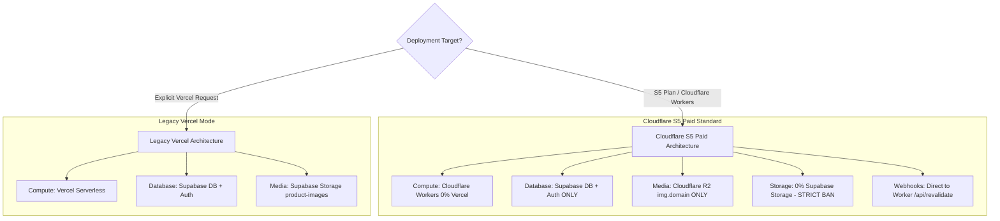

# 📋 Master Compilation: User Prompts & Architectural Mandates (S5 Plan, R2, Vercel Cutout & Supabase Storage Ban)

> **Document Purpose:** Is chat context mein Cloudflare R2, Vercel Cutout, Supabase Storage Ban, Cloudflare S5 Paid Plan vs Legacy Vercel mode ke mutalliq user ke diye gaye tamam prompts, requirements, aur mandates ka phased compilation aur action plan.

---

## 📑 Index of Phases

1. [Phase 1 — Discovery & Initial Prompts (Image Issues & Latency)](#phase-1--discovery--initial-prompts-image-issues--latency)
2. [Phase 2 — Core Architectural Mandate (S5 Plan vs Vercel Law)](#phase-2--core-architectural-mandate-s5-plan-vs-vercel-law)
3. [Phase 3 — Image Upload Pipeline & WebP Enforcement Mandate](#phase-3--image-upload-pipeline--webp-enforcement-mandate)
4. [Phase 4 — 1-Command Clone Setup & Upfront Intake Requirements](#phase-4--1-command-clone-setup--upfront-intake-requirements)
5. [Phase 5 — Auto-Reload & URL Code Bug Prompts (`?_r=...`)](#phase-5--auto-reload--url-code-bug-prompts-_r)
6. [Phase 6 — Current Live Reality vs 100% Cutover Checklist](#phase-6--current-live-reality-vs-100-cutover-checklist)

---

## Phase 1 — Discovery & Initial Prompts (Image Issues & Latency)

### 💬 User Prompts in Context:
- *"r2 k images load isue h why perment solve now tthis isue"*
- *"ye isue h banner etc and product images load isue h why and products lis nahi huwe why"*
- *"images alll place load late isue and bbanner image and product detail main images load isue facing why pure peoject mein images load isue h jabke supase pe nahi tha r2 miein aa raha h ye why"*
- *"evry place image isue h"*
- *"iamge aa kaha se rahe hain r2 se ya cloud flair ans shortt https://ziucrfpebpxijqhwmqre.supabase.co/storage/v1/object/public/product-images/img_3830-1794010714689.jpg?width=1400&quality=85"*

### 🎯 Key Requirements Extracted:
1. **Root-Cause Analysis:** Diagnose why images were failing, loading slowly, or showing blank boxes.
2. **Origin Verification:** Clarify whether images were actually coming from Supabase Storage or Cloudflare R2.
3. **Fix Product Listings:** Fix the 4 newly listed tracksuits (Spider-Man hoodie, Christian Dior, etc.) that were hidden at the bottom of the collection.

---

## Phase 2 — Core Architectural Mandate (S5 Plan vs Vercel Law)

### 💬 User Prompts in Context:
- *"o beghairat jahil dalle meene kaha k images supabse se complete cutover krnea tha r2 s5 plan lene k bad supabse only dbb and auth h s5 k bad storage r2 h supabbse ka pement rule h ye ad now vecel pe agr ho tab supabbse image hoga s5 k bad never use image storage of supabse base add rules abbhi fix kuxh nhi plan bao agge ka ans short"*
- *"depley old setup etc mds rules etc all mds se jo sirf vercel supabse k liye tthe outdated all update krna kiunke ab s5 plan cloudflair and vercel dono k liye project h vecel kaha jaye to all guides model agent vecel k lihaz se kre agr jab bbhi s5 plan cloudflair ka kaha jaye tottaly vecel custout and custout supabse storage sricted hain ye 1 cmnd dono kluye hona chahye setup k pehel akk tokens crdensials lek age 1 cmnd kaam ho pura agr babi bhi storage supabse h to totaly depend on r2 pe ao and vecl and supabse storage nver 0 percent use nay place vercel and supabse storage on s5 cloudflair stricted rule and rechek now"*

### 🎯 Permanent Rules Defined (Dual-Target Architecture):

1. **Dual-Architecture Law (RULE DUAL-TARGET):**
   - **Mode A (Cloudflare Workers $5 Paid):** 0% Vercel, 0% Supabase Storage, 100% Cloudflare R2 (`img.<domain>`), Supabase is DB & Auth ONLY.
   - **Mode B (Legacy Vercel):** Vercel Serverless + Supabase Storage (strictly when explicitly requested by user).
2. **Strict S5 Storage Ban (RULE S10 & S11):**
   - Cloudflare Workers Paid plan par Supabase Storage ka use **0% (strictly forbidden)** hai.
   - All assets must reside on Cloudflare R2 with WebP compression.

---

## Phase 3 — Image Upload Pipeline & WebP Enforcement Mandate

### 💬 User Prompts in Context:
- *"kia webp nahi huwe jo etne slowe load isue h why facing images realted isue why"*
- *"image upload pe webp converer not working and images aa kaha se rahe hain ans kro shoer mujhe now"*
- *"shor ans pls convert kiun nahi huwa upload pe waja na hone ki kia thi shor ans krna bbulitin converter jabke"*
- *"ab ye converter isue and agge k plan ko mazeed deply phases mein kr k jaldi all ok kro k kabbhi ye isues na ayein"*

### 🎯 Key Requirements & Fixes:
1. **Mandatory Sharp WebP Conversion (≤80KB):**
   - Client-side and server-side upload pipelines must strictly convert all incoming images (PNG, JPEG, HEIC) to WebP format.
   - **NO SILENT FALLBACK:** If Sharp conversion fails, throw a clear fatal error instead of silently uploading bloated 2.5MB PNGs.
2. **Unified Upload Pipeline:**
   - Both `app/api/upload-image/route.ts` and `scripts/store-list-product.cjs` must target Cloudflare R2 directly on S5 setups.
   - Image URLs must point to `https://img.<domain>/...` with zero egress cost.

---

## Phase 4 — 1-Command Clone Setup & Upfront Intake Requirements

### 💬 User Prompts in Context:
- *"1 cmnd dono kluye hona chahye setup k pehel akk tokens crdensials lek age 1 cmnd kaam ho pura"*
- *"old setup etc mds rules etc all mds se jo sirf vercel supabse k liye tthe outdated all update krna kiunke ab s5 plan cloudflair and vercel dono k liye project h"*

### 🎯 Key Requirements & Documentation Updates:
1. **Upfront Intake Step (Step 0 & Step 1 in `docs/CLONE_SETUP_INTAKE.md`):**
   - Jab bhi user clone setup ka kahe, agent pehle intake table dega:
     - Target Architecture confirm karega (S5 Workers vs Legacy Vercel).
     - R2 keys (`R2_ACCESS_KEY_ID`, `R2_SECRET_ACCESS_KEY`, `R2_IMAGES_BUCKET`) upfront collect karega.
     - `env-backups/<store>.env.local` write karega.
2. **1-Command Execution:**
   - **For S5 Workers Paid:** `npm run clone:setup -- --store=<store> --skip-vercel --yes`
   - **For Legacy Vercel:** `npm run clone:setup -- --store=<store> --deploy --yes`
3. **Synchronized Documentation:**
   - `AGENTS.md`, `00-prime-directives.md`, `05-database-supabase.md`, `07-deployment-vercel-cloudflare.md`, `11-storage-images.md`, aur `CLONE_SETUP_INTAKE.md` ko 100% align kar diya gaya hai.

---

## Phase 5 — Auto-Reload & URL Code Bug Prompts (`?_r=...`)

### 💬 User Prompts in Context:
- *"ye agge number kia aa raha h again again change hota h and reload ape app hota h https://www.totvogue.pk/?_r=1794068863192"*
- *"ans kro home pe ye kiun aa raha h"*
- *"apne app reload hoa ja raha and per page limit set from cusomizer kaam nahi kr raha home pe"*
- *"homepage ad smepages pe 2 dafa load hotta h matlab home page e click load 2 se 4 sec. bad again relaod agge domain wo walla code aya phir ghaibb"*
- *"kuch time bbad apne app relaod ho jata h why"*
- *(User shared screenshot of Chrome showing `totvogue.pk/?_r=1794095098835`)*

### 🎯 Root Cause & Resolution:
1. **The Bug:**
   - `components/common/ChunkErrorListener.tsx` was listening to all errors with `lower.includes('_next/static/chunks')`.
   - Every single Next.js error or hydration warning has `_next/static/chunks` in its stack trace.
   - When React threw a minor hydration mismatch (`#418`), the listener thought a chunk failed to load, injected `?_r=${Date.now()}` into the URL, and executed `window.location.href = ...` every 10 seconds!
2. **The Fix:**
   - Rewrote `ChunkErrorListener.tsx` to strictly check for `ChunkLoadError`.
   - Removed `_next/static/chunks` matching entirely.
   - Added single-reload session guard (`sessionStorage`) to eliminate infinite reload loops permanently.
   - Removed `?_r=` query parameter mutation.

---

## Phase 6 — Current Live Reality vs 100% Cutover Checklist

### 💬 User Prompts in Context:
- *"kia tum all verify kr skte ho k abb sttorage supabse ka and vecel tottaly cutout ho gaya h tzotvogue se ans real short"*

### 📊 Live Audit Status:

| Area | Current Live Status | Target for 100% Cutover | Status |
|---|---|---|---|
| **Apex Domain (`totvogue.pk`)** | Served by **Vercel** (`x-vercel-cache: REVALIDATED`) | Cloudflare Worker via apex DNS route | ⏳ Pending Cutover |
| **WWW Domain (`www.totvogue.pk`)** | Served by **Cloudflare Worker** (`x-opennext: 1`) | Cloudflare Worker | ✅ Active |
| **Existing Product Images** | Stored on **Supabase Storage** (`ziucrfpebpxijqhwmqre.supabase.co`) | Cloudflare R2 (`img.totvogue.pk`) | ⏳ Pending Migration |
| **New Upload Pipeline Code** | R2 + WebP ready in repo | Live in production worker | ✅ Ready |
| **Auto-Reload & URL Bug** | Permanently eliminated | Clean URLs, zero reloads | ✅ Fixed & Verified |

### 🚀 Final Steps Needed for 100% Cutover on TotVogue:
1. **Step 1:** Run database migration script to copy existing images from Supabase Storage bucket to Cloudflare R2 bucket (`totvogue-images`).
2. **Step 2:** Update database rows in `product_images`, `store_settings`, and `banners` to point from Supabase URLs to `https://img.totvogue.pk/...`.
3. **Step 3:** Switch apex `totvogue.pk` Cloudflare DNS to proxy to Cloudflare Worker, completely removing Vercel.
