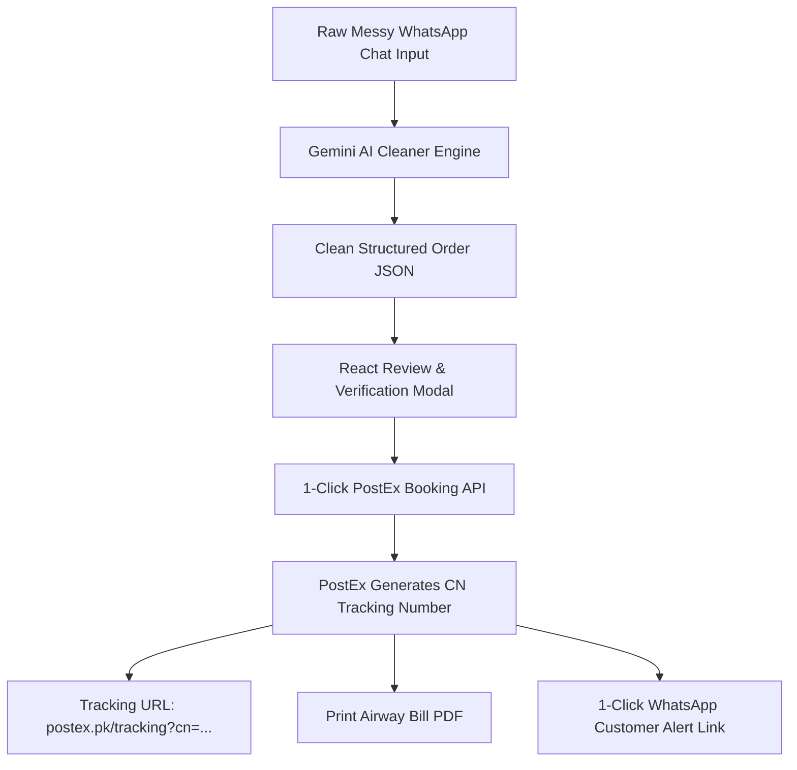

# Complete Architecture & Implementation Guide: Gemini AI & PostEx Courier API

> **Purpose:** Comprehensive deep-dive documentation of how the **Google Gemini AI Engine** and the **PostEx Courier API Engine** are built in this project, plus a step-by-step blueprint & ready-to-use React/Node code to build an **Automated WhatsApp Garbage Data Cleaner & 1-Click PostEx CN Booking Portal** for your other project.

---

## TABLE OF CONTENTS
1. [PART 1: Gemini AI Architecture in this Project](#part-1-gemini-ai-architecture-in-this-project)
   - [1.1 Model Recommendations & Benchmarks](#11-model-recommendations--benchmarks)
   - [1.2 Why `gemini-3-flash-preview` is the #1 Recommended Default](#12-why-gemini-3-flash-preview-is-the-1-recommended-default)
   - [1.3 API Key Management, Security & Key Pool Rotation](#13-api-key-management-security--key-pool-rotation)
   - [1.4 The API Engine Implementation (`callGoogle`)](#14-the-api-engine-implementation-callgoogle)
   - [1.5 Speed Optimization: Disabling Thinking Budget](#15-speed-optimization-disabling-thinking-budget)
   - [1.6 JSON Schema Enforcement & Thought Stripping](#16-json-schema-enforcement--thought-stripping)
2. [PART 2: PostEx Courier API Architecture in this Project](#part-2-postex-courier-api-architecture-in-this-project)
   - [2.1 API Base URLs & Authentication](#21-api-base-urls--authentication)
   - [2.2 Phone Number Sanitization (Local vs International)](#22-phone-number-sanitization-local-vs-international)
   - [2.3 Core Endpoint 1: Merchant Address Lookup](#23-core-endpoint-1-merchant-address-lookup)
   - [2.4 Core Endpoint 2: Operational Cities & Fallback Dictionary](#24-core-endpoint-2-operational-cities--fallback-dictionary)
   - [2.5 Core Endpoint 3: Create Order & Generate Dispatch CN](#25-core-endpoint-3-create-order--generate-dispatch-cn)
   - [2.6 Core Endpoint 4: Airway Bill PDF Label Download](#26-core-endpoint-4-airway-bill-pdf-label-download)
   - [2.7 Core Endpoint 5: Cancel Shipment](#27-core-endpoint-5-cancel-shipment)
   - [2.8 Customer Tracking Link & WhatsApp Alert Flow](#28-customer-tracking-link--whatsapp-alert-flow)
3. [PART 3: Blueprint for Other Project (WhatsApp Chat Cleaner -> PostEx CN Portal)](#part-3-blueprint-for-other-project-whatsapp-chat-cleaner---postex-cn-portal)
   - [3.1 System Flow Architecture](#31-system-flow-architecture)
   - [3.2 Gemini Prompt Engine for Roman Urdu/Messy WhatsApp Chats](#32-gemini-prompt-engine-for-roman-urdumessy-whatsapp-chats)
   - [3.3 Complete Backend Cleaner Implementation (`parseWhatsAppOrder.ts`)](#33-complete-backend-cleaner-implementation-parsewhatsapporderts)
   - [3.4 Complete PostEx Dispatch Service (`postexBookingService.ts`)](#34-complete-postex-dispatch-service-postexbookingservicets)
   - [3.5 Complete React Frontend Component (`WhatsAppDispatchPortal.tsx`)](#35-complete-react-frontend-component-whatsappdispatchportaltsx)
4. [PART 4: Production Checklist & Error Handling](#part-4-production-checklist--error-handling)

---

# PART 1: Gemini AI Architecture in this Project

In this codebase, all AI operations (product analysis, vision detection, SEO meta writing, title generator, and chat) are routed through a unified, resilient abstraction layer located in:
- `lib/ai/google.ts` — Core Google Generative Language API caller
- `lib/ai/call-ai.ts` — High-level provider selector, key pooler, and fallback orchestrator
- `lib/ai/router.ts` — Rate-limit tracker and multi-provider failover
- `lib/ai/settings.ts` — Decrypts server secrets and loads persona configuration

---

### 1.1 Model Recommendations & Benchmarks

Google's Generative Language API offers multiple models. Here is the exact compatibility and recommendation table:

| Model ID | Best For | Speed | Free Tier Quota | Recommendation |
| :--- | :--- | :---: | :---: | :--- |
| **`gemini-3-flash-preview`** | **Text Extraction, Data Parsing, Vision, SEO** | **1.2s – 2.0s** | **1,500 req/day (15 RPM)** | **🌟 BEST (Default Choice)** — Ultra-fast, highly accurate on unstructured chat & addresses, free daily quota. |
| **`gemini-3.1-flash-lite`** | **High-volume simple string parsing** | **0.8s – 1.4s** | **1,500 req/day (15 RPM)** | **⚡ FASTEST** — Extremely lightweight. (Note: does not support thinking config). |
| **`gemini-3.5-flash`** | **Complex multi-lingual reasoning** | **2.0s – 3.5s** | **1,500 req/day (15 RPM)** | **Good Fallback** — Reliable when deeper reasoning is needed. |
| **`gemini-1.5-flash` / `2.0-flash`** | *Legacy / Deprecated versions* | Variable | Deprecated / Rate-limited | Automatically normalized in code to `gemini-3-flash-preview`. |

---

### 1.2 Why `gemini-3-flash-preview` is the #1 Recommended Default

1. **Multimodal Native:** Processes both text (WhatsApp conversations) and images (customer screenshots of payment receipts or product photos) in the same API call.
2. **Pakistani Roman Urdu Understanding:** Exceptional at parsing mixed Roman Urdu + English text (e.g., *"bhai mujhe 2 piece dress chahiye, address flat 404 gulshan karachi, phone 03001234567, payment delivery pe dunga"*).
3. **Structured JSON Output:** Google's `responseMimeType: "application/json"` guarantees strictly valid JSON with 0 markdown backticks.
4. **Zero-Cost Operation:** 1,500 free requests per day is sufficient for 1,500 order bookings daily per API key!

---

### 1.3 API Key Management, Security & Key Pool Rotation

#### How Keys are Saved:
- Keys are entered in Admin Settings under **Settings > AI Tab** or via `.env.local` (`GEMINI_API_KEY`).
- In Supabase DB table `store_settings`:
  - `ai_model_credentials` stores a JSONB object mapping `{ "vision": { "gemini": "key1\nkey2" }, "content": { "gemini": "key1\nkey2" } }`.
  - Column is encrypted using `decryptSecret` / `encryptSecret` (`lib/utils/secret-crypto.ts`).
  - Strict RLS and server-only endpoints (`lib/services/settings/server-secrets.ts`) prevent exposing secret keys to client browser JavaScript.

#### Multi-Key Rotation Pool:
In `lib/ai/call-ai.ts`, keys can be separated by newlines (`\n`):
```typescript
const settingsKeys = keysRaw.split('\n').map((k) => k.trim()).filter(Boolean);
const envGemini = (process.env.GEMINI_API_KEY || process.env.GOOGLE_API_KEY)?.trim();

// Combine all available keys into a single pool
let keys = Array.from(new Set([...settingsKeys, ...(envGemini ? [envGemini] : [])]));
```
If **Key 1** hits HTTP `429` (Quota Exhaustion) or `503` (High Traffic), the engine catches the error, rotates immediately to **Key 2**, and completes the user's request without failing.

---

### 1.4 The API Engine Implementation (`callGoogle`)

Direct implementation pattern used in `lib/ai/google.ts`:

```typescript
export async function callGoogle(
  apiKey: string,
  model: string,
  prompt: string,
  systemPrompt: string,
  isVision: boolean = false,
  base64Data?: string,
  mimeType?: string
): Promise<string> {
  const currentModel = model || 'gemini-3-flash-preview';
  const url = `https://generativelanguage.googleapis.com/v1beta/models/${currentModel}:generateContent?key=${apiKey}`;

  // 1. Build Payload Parts
  const parts: Array<{ text?: string; inlineData?: { mimeType: string; data: string } }> = [];
  
  if (isVision && base64Data) {
    parts.push({
      inlineData: {
        mimeType: mimeType || 'image/webp',
        data: base64Data,
      },
    });
  }
  parts.push({ text: prompt });

  const body: any = {
    contents: [{ role: 'user', parts }],
  };

  // 2. Add System Instruction
  if (systemPrompt && systemPrompt.trim()) {
    body.systemInstruction = { parts: [{ text: systemPrompt }] };
  }

  // 3. Force JSON output if requested
  const wantsJson = /json|\{|\}/i.test(prompt) || /json/i.test(systemPrompt);
  if (wantsJson) {
    body.generationConfig = { responseMimeType: 'application/json' };
  }

  // 4. Disable Thinking Tokens (speeds up response from 14s to 1.5s)
  if (currentModel.startsWith('gemini-') && !currentModel.includes('lite')) {
    body.generationConfig = {
      ...(body.generationConfig || {}),
      thinkingConfig: { thinkingBudget: 0 },
    };
  }

  // 5. Execute Request with Timeout
  const controller = new AbortController();
  const timer = setTimeout(() => controller.abort(), 15000);

  try {
    const res = await fetch(url, {
      method: 'POST',
      headers: { 'Content-Type': 'application/json' },
      body: JSON.stringify(body),
      signal: controller.signal,
    });

    if (!res.ok) {
      const errJson = await res.json().catch(() => ({}));
      throw new Error(errJson?.error?.message || `Google API error ${res.status}`);
    }

    const json = await res.json();
    
    // 6. Extract clean response and strip internal thoughts
    const responseParts = json?.candidates?.[0]?.content?.parts || [];
    const nonThought = responseParts.filter((p: any) => !p.thought);
    const text = (nonThought.length > 0 ? nonThought : responseParts)
      .map((p: any) => p.text || '')
      .join('')
      .trim();

    return text;
  } finally {
    clearTimeout(timer);
  }
}
```

---

### 1.5 Speed Optimization: Disabling Thinking Budget
Recent Gemini models (Gemini 2.5/3 Flash) default to "extended thinking", which outputs hidden reasoning tokens and increases response latency to 10–14 seconds.
By passing:
```json
"generationConfig": {
  "thinkingConfig": {
    "thinkingBudget": 0
  }
}
```
Gemini responds in **1.2 to 1.8 seconds**, which is essential for a snappy interactive portal.
*(Note: Do not pass `thinkingConfig` to `-lite` models like `gemini-3.1-flash-lite`, as they reject this parameter with HTTP 400).*

---

### 1.6 JSON Schema Enforcement & Thought Stripping
When receiving a response from Gemini:
```typescript
const responseParts = json?.candidates?.[0]?.content?.parts || [];
// Filter out reasoning thoughts
const nonThought = responseParts.filter((p) => !p.thought);
const text = nonThought.map((p) => p.text || '').join('').trim();
```
With `responseMimeType: 'application/json'`, `text` can be safely passed to `JSON.parse(text)` without needing regex cleanups like ```` ```json ```` markdown wrappers.

---

# PART 2: PostEx Courier API Architecture in this Project

PostEx is one of Pakistan's leading COD e-commerce logistics providers. In this project, all PostEx communication is centralized under:
- `app/api/courier/postex/dispatch/route.ts` — Order booking & CN generation
- `app/api/courier/postex/cities/route.ts` — Operational delivery cities lookup
- `app/api/courier/postex/test/route.ts` — Merchant address & credential testing
- `app/api/courier/postex/labels/route.ts` — PDF Airway Bill generation
- `app/api/courier/postex/cancel/route.ts` — Shipment cancellation

---

### 2.1 API Base URLs & Authentication

PostEx operates two environments:
- **Production API:** `https://api.postex.pk/services/integration/api`
- **Sandbox / Staging API:** `https://staging-api.postex.pk/services/integration/api`
- **Airway Bill Report API:** `https://api.postex.pk/services/reporting/api/report/integration`

#### Authentication Header:
PostEx does **not** use `Bearer <token>`. The header name is strictly `token`:
```http
POST /services/integration/api/order/v3/create-order HTTP/1.1
Host: api.postex.pk
token: your_postex_api_token_here
Content-Type: application/json
Accept: application/json
```

---

### 2.2 Phone Number Sanitization (Local vs International)

PostEx and WhatsApp require different phone number formats:
1. **PostEx Format:** Requires an 11-digit local format starting with `0` (e.g., `03001234567`).
2. **WhatsApp Format:** Requires international format without leading `+` or `0` (e.g., `923001234567`).

In `app/api/courier/postex/dispatch/route.ts`:
```typescript
// Sanitizes to: 03001234567 (For PostEx API)
export function cleanPhoneForPostEx(phone: string): string {
  let digits = (phone || '').replace(/\D/g, '');
  if (digits.startsWith('92') && digits.length === 12) {
    digits = '0' + digits.substring(2);
  }
  if (digits.length === 10 && digits.startsWith('3')) {
    digits = '0' + digits;
  }
  return digits;
}

// Sanitizes to: 923001234567 (For WhatsApp wa.me links)
export function toInternationalPhone(phone: string): string {
  if (!phone) return '';
  let clean = phone.replace(/\D/g, '');
  if (clean.startsWith('0') && clean.length === 11) {
    clean = '92' + clean.slice(1);
  } else if (clean.startsWith('3') && clean.length === 10) {
    clean = '92' + clean;
  } else if (clean.startsWith('920') && clean.length === 13) {
    clean = '92' + clean.slice(3);
  }
  return clean;
}
```

---

### 2.3 Core Endpoint 1: Merchant Address Lookup

Before creating an order, PostEx requires a `pickupAddressCode` indicating which warehouse or shop the courier should pick the parcel up from.

- **Method:** `GET`
- **URL:** `https://api.postex.pk/services/integration/api/order/v1/get-merchant-address`
- **Headers:** `{ "token": "<POSTEX_TOKEN>", "Content-Type": "application/json" }`

#### Sample Response:
```json
{
  "statusCode": "0200",
  "statusMessage": "Success",
  "dist": [
    {
      "addressCode": "001",
      "addressType": "Pickup Address",
      "cityName": "KARACHI",
      "address": "Shop # 12, Main Commercial Area, Zamzama, Karachi"
    },
    {
      "addressCode": "002",
      "addressType": "Return Address",
      "cityName": "KARACHI",
      "address": "Warehouse # 4, Korangi Industrial Area, Karachi"
    }
  ]
}
```
Save the `addressCode` (e.g. `"001"`) in your settings as the `pickupAddressCode`.

---

### 2.4 Core Endpoint 2: Operational Cities & Fallback Dictionary

PostEx validates cities against its operational coverage list. If a city name is misspelled (e.g., "KHI" instead of "KARACHI"), PostEx rejects the booking.

- **Method:** `GET`
- **URL:** `https://api.postex.pk/services/integration/api/order/v2/get-operational-city?operationalCityType=delivery`
- **Headers:** `{ "token": "<POSTEX_TOKEN>", "Content-Type": "application/json" }`

In `app/api/courier/postex/cities/route.ts`, this project maintains a verified fallback list of **105+ official PostEx cities** (including `KARACHI`, `LAHORE`, `ISLAMABAD`, `RAWALPINDI`, `FAISALABAD`, `MULTAN`, `PESHAWAR`, `QUETTA`, `SIALKOT`, `HYDERABAD`, `GUJRANWALA`, etc.) to ensure instant auto-complete and offline reliability.

---

### 2.5 Core Endpoint 3: Create Order & Generate Dispatch CN

This is the main booking endpoint that books the parcel with PostEx and generates the Tracking / Consignment Note (CN).

- **Method:** `POST`
- **URL:** `https://api.postex.pk/services/integration/api/order/v3/create-order`
- **Headers:**
  ```http
  token: your_postex_api_token
  Content-Type: application/json
  Accept: application/json
  ```

#### Request Payload:
```json
{
  "cityName": "Karachi",
  "customerName": "Ali Khan",
  "customerPhone": "03001234567",
  "deliveryAddress": "Flat 404, Building 12, Gulshan-e-Iqbal, Block 13-D",
  "invoiceDivision": 1,
  "invoicePayment": 2500,
  "items": 1,
  "orderDetail": "Embroidered 2pc Dress (Black)",
  "orderRefNumber": "WA-1082",
  "orderType": "Normal",
  "transactionNotes": "Call before delivery",
  "pickupAddressCode": "001",
  "weight": 0.5
}
```

#### Field Explanations:
- `cityName`: City name in Pakistan (Must match PostEx valid city names).
- `customerName`: Full name of recipient.
- `customerPhone`: 11-digit phone number starting with `0`.
- `deliveryAddress`: Complete delivery street address.
- `invoicePayment`: Amount to collect as Cash On Delivery (PKR). If already prepaid, pass `0`.
- `items`: Number of pieces inside the parcel.
- `orderDetail`: Short summary of items inside.
- `orderRefNumber`: Your internal Order ID or WhatsApp Order Number.
- `orderType`: `"Normal"` (Standard COD delivery) or `"Overnight"`.
- `transactionNotes`: Instructions printed on courier slip (e.g. *"Call before delivery"*).
- `pickupAddressCode`: The warehouse/shop address code from `get-merchant-address`.
- `weight`: Weight in KG (e.g. `0.5`, `1.0`).

#### Sample Response:
```json
{
  "statusCode": "0200",
  "statusMessage": "Order Created Successfully",
  "dist": {
    "trackingNumber": "29469620000358",
    "orderRefNumber": "WA-1082",
    "transactionStatus": "Un-Assigned",
    "cityName": "Karachi",
    "invoicePayment": 2500
  }
}
```

---

### 2.6 Core Endpoint 4: Airway Bill PDF Label Download

To print the courier thermal sticker / label for the parcel:

- **Method:** `POST`
- **URL:** `https://api.postex.pk/services/reporting/api/report/integration/airway-bill`
- **Headers:**
  ```http
  token: your_postex_api_token
  Content-Type: application/json
  ```
- **Body:** Array of tracking numbers:
  ```json
  ["29469620000358", "21469620000326"]
  ```

#### Response:
`data.dist` returns a **Base64-encoded PDF string**.
In Node.js, decode this string into a binary buffer to output a downloadable PDF:
```typescript
const pdfBuffer = Buffer.from(data.dist, 'base64');
res.setHeader('Content-Type', 'application/pdf');
res.setHeader('Content-Disposition', 'attachment; filename="postex-label.pdf"');
res.send(pdfBuffer);
```

---

### 2.7 Core Endpoint 5: Cancel Shipment

If a customer cancels an order after booking:

- **Method:** `PUT`
- **URL:** `https://api.postex.pk/services/integration/api/order/v1/cancel-order`
- **Headers:** `{ "token": "<POSTEX_TOKEN>", "Content-Type": "application/json" }`
- **Body:**
  ```json
  {
    "trackingNumber": "29469620000358"
  }
  ```

---

### 2.8 Customer Tracking Link & WhatsApp Alert Flow

Once PostEx returns `trackingNumber: "29469620000358"`:

#### 1. Live Public Tracking Link:
```
https://postex.pk/tracking?cn=29469620000358
```
*(This link opens PostEx's real-time shipment status portal for the customer).*

#### 2. WhatsApp Customer Confirmation Message:
```text
Dear Ali Khan,

Your order has been booked! 🚚

📦 Items: Embroidered 2pc Dress (Black)
💰 COD Amount: Rs. 2,500
🔍 Tracking Number: 29469620000358

Live Tracking Link:
https://postex.pk/tracking?cn=29469620000358

Please keep tracking your parcel. If you do not receive it within 3 to 5 working days, please message us on WhatsApp with your Order ID.

Thank you for shopping with us!
```

#### 3. 1-Click WhatsApp Send Link:
```
https://wa.me/923001234567?text=...encodedMessage...
```

---

# PART 3: Blueprint for Other Project (WhatsApp Chat Cleaner -> PostEx CN Portal)

Here is the turnkey architecture and complete, copy-paste ready code designed specifically for your other React project.

### 3.1 System Flow Architecture



---

### 3.2 Gemini Prompt Engine for Roman Urdu/Messy WhatsApp Chats

This specialized prompt handles misspelled Pakistani cities, scattered phone numbers with spaces or dashes, and mixed Urdu/English text:

```typescript
export const WHATSAPP_CLEANER_SYSTEM_PROMPT = `You are an expert Pakistani e-commerce order extraction assistant.
You specialize in reading chaotic, messy, unstructured WhatsApp chat messages in English, Roman Urdu, and Urdu.
Extract the order data and return ONLY a valid JSON object matching the requested schema.
Rules:
1. Normalize phone numbers into 11-digit format starting with 03 (e.g. '03001234567').
2. Match city to official Pakistani cities (e.g., 'khi' -> 'Karachi', 'lhr' -> 'Lahore', 'isb' -> 'Islamabad', 'pindi' -> 'Rawalpindi', 'fsd' -> 'Faisalabad', 'mul' -> 'Multan').
3. Clean delivery address: exclude greetings, exclude city from address if redundant, but keep house/street/area/colony details.
4. Extract COD total amount as a number (e.g., 2500). If prepaid or free delivery is mentioned, note it.
5. Extract item names, color, size, and quantities.`;
```

---

### 3.3 Complete Backend Cleaner Implementation (`parseWhatsAppOrder.ts`)

```typescript
// services/ai/cleanWhatsAppOrder.ts

export interface CleanedOrder {
  customerName: string;
  customerPhone: string;
  deliveryAddress: string;
  cityName: string;
  orderDetail: string;
  itemsCount: number;
  invoicePayment: number;
  remarks: string;
}

export async function parseWhatsAppChat(
  chatText: string,
  geminiApiKey: string
): Promise<CleanedOrder> {
  const url = `https://generativelanguage.googleapis.com/v1beta/models/gemini-3-flash-preview:generateContent?key=${geminiApiKey}`;

  const prompt = `Extract order details from this WhatsApp chat text:
---
${chatText}
---

Return ONLY valid JSON matching this schema:
{
  "customerName": "Full Name",
  "customerPhone": "03001234567",
  "deliveryAddress": "Complete street address without city",
  "cityName": "Recognized Pakistan City Name (e.g. Karachi, Lahore, Islamabad)",
  "orderDetail": "Summary of items, size, color",
  "itemsCount": 1,
  "invoicePayment": 2500,
  "remarks": "Special instructions (e.g. Call before delivery)"
}`;

  const response = await fetch(url, {
    method: 'POST',
    headers: { 'Content-Type': 'application/json' },
    body: JSON.stringify({
      contents: [{ role: 'user', parts: [{ text: prompt }] }],
      systemInstruction: {
        parts: [{
          text: `You are an AI order parser for Pakistan e-commerce. You extract clean shipping info from Roman Urdu WhatsApp chats. Return ONLY valid JSON.`
        }]
      },
      generationConfig: {
        responseMimeType: 'application/json',
        thinkingConfig: { thinkingBudget: 0 }
      }
    })
  });

  if (!response.ok) {
    const err = await response.json().catch(() => ({}));
    throw new Error(err?.error?.message || `Gemini failed: ${response.status}`);
  }

  const json = await response.json();
  const rawParts = json?.candidates?.[0]?.content?.parts || [];
  const text = rawParts.filter((p: any) => !p.thought).map((p: any) => p.text || '').join('').trim();

  const data: CleanedOrder = JSON.parse(text);

  // Fallback sanitization
  data.customerPhone = data.customerPhone.replace(/\D/g, '');
  if (data.customerPhone.startsWith('92') && data.customerPhone.length === 12) {
    data.customerPhone = '0' + data.customerPhone.slice(2);
  }

  return data;
}
```

---

### 3.4 Complete PostEx Dispatch Service (`postexBookingService.ts`)

```typescript
// services/courier/postexService.ts

export interface PostExBookingParams {
  postexToken: string;
  pickupAddressCode: string; // e.g. "001"
  cityName: string;
  customerName: string;
  customerPhone: string;
  deliveryAddress: string;
  invoicePayment: number;
  itemsCount: number;
  orderDetail: string;
  orderRefNumber: string;
  remarks?: string;
  weight?: number;
}

export interface PostExBookingResult {
  success: boolean;
  trackingNumber: string;
  trackingUrl: string;
  whatsAppAlertUrl: string;
  error?: string;
}

export async function bookPostExOrder(params: PostExBookingParams): Promise<PostExBookingResult> {
  const url = 'https://api.postex.pk/services/integration/api/order/v3/create-order';

  // 1. Ensure phone number is strictly 03XXXXXXXXX format
  let cleanPhone = params.customerPhone.replace(/\D/g, '');
  if (cleanPhone.startsWith('92') && cleanPhone.length === 12) {
    cleanPhone = '0' + cleanPhone.slice(2);
  }

  // 2. Build PostEx payload
  const payload = {
    cityName: params.cityName,
    customerName: params.customerName,
    customerPhone: cleanPhone,
    deliveryAddress: params.deliveryAddress,
    invoiceDivision: 1,
    invoicePayment: Number(params.invoicePayment) || 0,
    items: Number(params.itemsCount) || 1,
    orderDetail: params.orderDetail || 'Parcel',
    orderRefNumber: params.orderRefNumber || `ORD-${Date.now().toString().slice(-6)}`,
    orderType: 'Normal',
    transactionNotes: params.remarks || 'Call before delivery',
    pickupAddressCode: params.pickupAddressCode,
    weight: params.weight || 0.5
  };

  const response = await fetch(url, {
    method: 'POST',
    headers: {
      'token': params.postexToken,
      'Content-Type': 'application/json',
      'Accept': 'application/json'
    },
    body: JSON.stringify(payload)
  });

  const resData = await response.json();

  if (response.status !== 200 && response.status !== 201) {
    return {
      success: false,
      trackingNumber: '',
      trackingUrl: '',
      whatsAppAlertUrl: '',
      error: resData.statusMessage || resData.message || `Booking failed (${response.status})`
    };
  }

  const trackingNumber = resData.dist?.trackingNumber || resData.trackingNumber || resData.data?.trackingNumber || '';
  const trackingUrl = `https://postex.pk/tracking?cn=${trackingNumber}`;

  // 3. Compose WhatsApp alert message
  const intlPhone = cleanPhone.startsWith('0') ? '92' + cleanPhone.slice(1) : cleanPhone;
  const waMsg = `Dear ${params.customerName},\n\nYour order has been booked! 🚚\n\n📦 Items: ${params.orderDetail}\n💰 COD Amount: Rs. ${params.invoicePayment}\n🔍 Tracking Number: ${trackingNumber}\n\nLive Tracking Link:\n${trackingUrl}\n\nPlease keep tracking your parcel. If you do not receive it within 3-5 working days, contact us with your order details.\n\nThank you!`;

  const whatsAppAlertUrl = `https://wa.me/${intlPhone}?text=${encodeURIComponent(waMsg)}`;

  return {
    success: true,
    trackingNumber,
    trackingUrl,
    whatsAppAlertUrl
  };
}
```

---

### 3.5 Complete React Frontend Component (`WhatsAppDispatchPortal.tsx`)

This component provides a complete user interface:
1. Paste messy raw WhatsApp chat $\rightarrow$ Click **"Clean with Gemini AI"**.
2. Inspect & edit the extracted fields (Name, Phone, Address, City, COD Price).
3. Click **"Book with PostEx"** $\rightarrow$ Instantly receives the Tracking CN.
4. One-click buttons to open the **PostEx Live Tracking Link** or **Send WhatsApp Alert to Customer**.

```tsx
// components/WhatsAppDispatchPortal.tsx
'use client';

import React, { useState } from 'react';

export default function WhatsAppDispatchPortal() {
  const [chatInput, setChatInput] = useState('');
  const [loadingAi, setLoadingAi] = useState(false);
  const [bookingLoading, setBookingLoading] = useState(false);

  // Cleaned Fields
  const [customerName, setCustomerName] = useState('');
  const [customerPhone, setCustomerPhone] = useState('');
  const [deliveryAddress, setDeliveryAddress] = useState('');
  const [cityName, setCityName] = useState('Karachi');
  const [orderDetail, setOrderDetail] = useState('');
  const [invoicePayment, setInvoicePayment] = useState(0);
  const [remarks, setRemarks] = useState('Call before delivery');

  // Booking Results
  const [bookingResult, setBookingResult] = useState<{
    trackingNumber: string;
    trackingUrl: string;
    whatsAppAlertUrl: string;
  } | null>(null);
  const [errorMsg, setErrorMsg] = useState('');

  // 1. Call Gemini to Parse WhatsApp Garbage Chat
  const handleCleanChat = async () => {
    if (!chatInput.trim()) return;
    setLoadingAi(true);
    setErrorMsg('');
    setBookingResult(null);

    try {
      const res = await fetch('/api/ai/clean-chat', {
        method: 'POST',
        headers: { 'Content-Type': 'application/json' },
        body: JSON.stringify({ chatText: chatInput }),
      });
      const data = await res.json();
      if (!res.ok || data.error) throw new Error(data.error || 'Failed to parse chat');

      setCustomerName(data.customerName || '');
      setCustomerPhone(data.customerPhone || '');
      setDeliveryAddress(data.deliveryAddress || '');
      setCityName(data.cityName || 'Karachi');
      setOrderDetail(data.orderDetail || '');
      setInvoicePayment(Number(data.invoicePayment) || 0);
      setRemarks(data.remarks || 'Call before delivery');
    } catch (e: any) {
      setErrorMsg(e.message || 'Error cleaning chat with Gemini');
    } finally {
      setLoadingAi(false);
    }
  };

  // 2. Book with PostEx
  const handleBookPostEx = async () => {
    setBookingLoading(true);
    setErrorMsg('');

    try {
      const res = await fetch('/api/courier/postex-book', {
        method: 'POST',
        headers: { 'Content-Type': 'application/json' },
        body: JSON.stringify({
          customerName,
          customerPhone,
          deliveryAddress,
          cityName,
          orderDetail,
          invoicePayment,
          remarks,
        }),
      });
      const data = await res.json();
      if (!res.ok || !data.success) throw new Error(data.error || 'Booking failed');

      setBookingResult({
        trackingNumber: data.trackingNumber,
        trackingUrl: data.trackingUrl,
        whatsAppAlertUrl: data.whatsAppAlertUrl,
      });
    } catch (e: any) {
      setErrorMsg(e.message || 'Error booking order with PostEx');
    } finally {
      setBookingLoading(false);
    }
  };

  return (
    <div style={{ maxWidth: 880, margin: '2rem auto', fontFamily: 'sans-serif', padding: '0 1rem' }}>
      <h2 style={{ fontSize: '1.5rem', fontWeight: 'bold', marginBottom: '0.5rem' }}>
        WhatsApp Chat Cleaner & PostEx CN Dispatch Portal
      </h2>
      <p style={{ color: '#666', marginBottom: '1.5rem', fontSize: '0.9rem' }}>
        Paste raw messy WhatsApp customer chats &rarr; Extract clean details with Gemini &rarr; Book directly to PostEx.
      </p>

      {/* Raw Chat Input Box */}
      <div style={{ background: '#f9fafb', padding: '1rem', borderRadius: 8, border: '1px solid #e5e7eb' }}>
        <label style={{ display: 'block', fontWeight: 600, marginBottom: '0.5rem' }}>
          Paste Raw WhatsApp Chat:
        </label>
        <textarea
          rows={5}
          value={chatInput}
          onChange={(e) => setChatInput(e.target.value)}
          placeholder="e.g. Bhai mujhe 1 black suit chahiye size M. Name Ali Khan, address Flat 404 block 13-D gulshan karachi, phone 0300-1234567 payment COD 2500..."
          style={{ width: '100%', padding: '0.75rem', borderRadius: 6, border: '1px solid #ccc', fontSize: '0.9rem', boxSizing: 'border-box' }}
        />
        <button
          onClick={handleCleanChat}
          disabled={loadingAi || !chatInput.trim()}
          style={{
            marginTop: '0.75rem',
            padding: '0.6rem 1.25rem',
            background: '#2563eb',
            color: '#fff',
            border: 'none',
            borderRadius: 6,
            fontWeight: 600,
            cursor: loadingAi ? 'not-allowed' : 'pointer'
          }}
        >
          {loadingAi ? '✨ Cleaning with Gemini AI...' : '✨ Clean & Extract Order Details'}
        </button>
      </div>

      {errorMsg && (
        <div style={{ background: '#fee2e2', color: '#b91c1c', padding: '0.75rem', borderRadius: 6, marginTop: '1rem' }}>
          ⚠️ {errorMsg}
        </div>
      )}

      {/* Structured Fields & PostEx Dispatch Form */}
      {(customerName || customerPhone || deliveryAddress) && (
        <div style={{ marginTop: '1.5rem', padding: '1.25rem', borderRadius: 8, border: '1px solid #d1d5db', background: '#fff' }}>
          <h3 style={{ fontSize: '1.1rem', fontWeight: 600, marginBottom: '1rem' }}>
            Verified Order Details (Review before booking)
          </h3>

          <div style={{ display: 'grid', gridTemplateColumns: '1fr 1fr', gap: '1rem' }}>
            <div>
              <label style={{ fontSize: '0.85rem', fontWeight: 600 }}>Customer Name</label>
              <input
                type="text"
                value={customerName}
                onChange={(e) => setCustomerName(e.target.value)}
                style={{ width: '100%', padding: '0.5rem', borderRadius: 4, border: '1px solid #ccc', marginTop: 4, boxSizing: 'border-box' }}
              />
            </div>

            <div>
              <label style={{ fontSize: '0.85rem', fontWeight: 600 }}>Customer Phone (03XXXXXXXXX)</label>
              <input
                type="text"
                value={customerPhone}
                onChange={(e) => setCustomerPhone(e.target.value)}
                style={{ width: '100%', padding: '0.5rem', borderRadius: 4, border: '1px solid #ccc', marginTop: 4, boxSizing: 'border-box' }}
              />
            </div>

            <div style={{ gridColumn: 'span 2' }}>
              <label style={{ fontSize: '0.85rem', fontWeight: 600 }}>Delivery Address</label>
              <input
                type="text"
                value={deliveryAddress}
                onChange={(e) => setDeliveryAddress(e.target.value)}
                style={{ width: '100%', padding: '0.5rem', borderRadius: 4, border: '1px solid #ccc', marginTop: 4, boxSizing: 'border-box' }}
              />
            </div>

            <div>
              <label style={{ fontSize: '0.85rem', fontWeight: 600 }}>City</label>
              <input
                type="text"
                value={cityName}
                onChange={(e) => setCityName(e.target.value)}
                style={{ width: '100%', padding: '0.5rem', borderRadius: 4, border: '1px solid #ccc', marginTop: 4, boxSizing: 'border-box' }}
              />
            </div>

            <div>
              <label style={{ fontSize: '0.85rem', fontWeight: 600 }}>COD Amount (PKR)</label>
              <input
                type="number"
                value={invoicePayment}
                onChange={(e) => setInvoicePayment(Number(e.target.value))}
                style={{ width: '100%', padding: '0.5rem', borderRadius: 4, border: '1px solid #ccc', marginTop: 4, boxSizing: 'border-box' }}
              />
            </div>

            <div style={{ gridColumn: 'span 2' }}>
              <label style={{ fontSize: '0.85rem', fontWeight: 600 }}>Item Summary</label>
              <input
                type="text"
                value={orderDetail}
                onChange={(e) => setOrderDetail(e.target.value)}
                style={{ width: '100%', padding: '0.5rem', borderRadius: 4, border: '1px solid #ccc', marginTop: 4, boxSizing: 'border-box' }}
              />
            </div>
          </div>

          <button
            onClick={handleBookPostEx}
            disabled={bookingLoading}
            style={{
              marginTop: '1.25rem',
              width: '100%',
              padding: '0.75rem',
              background: '#059669',
              color: '#fff',
              border: 'none',
              borderRadius: 6,
              fontSize: '1rem',
              fontWeight: 700,
              cursor: bookingLoading ? 'not-allowed' : 'pointer',
            }}
          >
            {bookingLoading ? '📦 Booking with PostEx...' : '🚀 Book with PostEx (Generate CN)'}
          </button>
        </div>
      )}

      {/* Success Booking Card */}
      {bookingResult && (
        <div style={{ marginTop: '1.5rem', background: '#ecfdf5', border: '1px solid #a7f3d0', padding: '1.25rem', borderRadius: 8 }}>
          <h4 style={{ color: '#065f46', margin: '0 0 0.5rem 0', fontSize: '1.1rem' }}>
            🎉 Parcel Successfully Booked with PostEx!
          </h4>
          <p style={{ margin: '0.25rem 0' }}>
            <strong>Tracking CN:</strong> <code style={{ fontSize: '1.1rem', background: '#fff', padding: '2px 6px', borderRadius: 4 }}>{bookingResult.trackingNumber}</code>
          </p>

          <div style={{ display: 'flex', gap: '0.75rem', marginTop: '1rem', flexWrap: 'wrap' }}>
            <a
              href={bookingResult.trackingUrl}
              target="_blank"
              rel="noopener noreferrer"
              style={{
                display: 'inline-block',
                background: '#2563eb',
                color: '#fff',
                textDecoration: 'none',
                padding: '0.5rem 1rem',
                borderRadius: 6,
                fontWeight: 600,
                fontSize: '0.9rem'
              }}
            >
              🔍 Open Live PostEx Tracking
            </a>

            <a
              href={bookingResult.whatsAppAlertUrl}
              target="_blank"
              rel="noopener noreferrer"
              style={{
                display: 'inline-block',
                background: '#16a34a',
                color: '#fff',
                textDecoration: 'none',
                padding: '0.5rem 1rem',
                borderRadius: 6,
                fontWeight: 600,
                fontSize: '0.9rem'
              }}
            >
              💬 Send WhatsApp Tracking Alert
            </a>
          </div>
        </div>
      )}
    </div>
  );
}
```

---

# PART 4: Production Checklist & Error Handling

### 4.1 PostEx API Edge Cases:
1. **Unrecognized City Error:** If PostEx returns `City is not operational`, display an auto-suggest dropdown populated with PostEx's official city list (`KARACHI`, `LAHORE`, etc.).
2. **Phone Number Rejection:** PostEx rejects phone numbers with dashes, spaces, or international codes (`+92`). Always run `phone.replace(/\D/g, '')` and convert `92` prefix to `0`.
3. **Pickup Address Code Missing:** Always ensure a valid `pickupAddressCode` from `/order/v1/get-merchant-address` is attached to every `create-order` request.

### 4.2 Gemini API Edge Cases:
1. **Quota Rate Limits (429):** Google provides 15 requests per minute on free tier. For higher volume, pool 2 to 3 free keys and rotate them sequentially.
2. **Thinking Latency:** Never omit `"thinkingBudget": 0` on Gemini 2.5/3 Flash models; this single setting makes parsing take **1.5 seconds instead of 14 seconds**.
3. **JSON Validity:** Always use `responseMimeType: "application/json"`. It guarantees valid JSON without needing markdown regex sanitizers.

---
*Created for: Full Stack E-Commerce & WhatsApp Logistics Portals*
